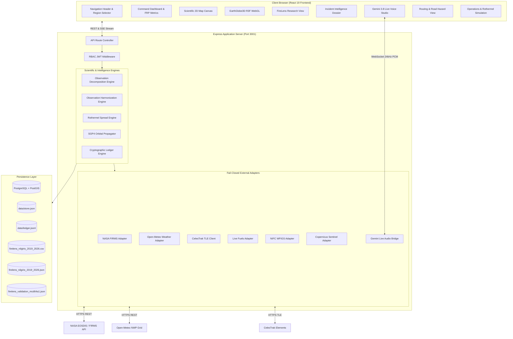

# ALEX & FireLens: System Architecture & Engineering Blueprint

## 1. Platform Overview & Mission
**ALEX (Autonomous Live Environmental eXpert)** is an autonomous multi-agent intelligence and Earth observation platform designed for wildland fire surveillance, causal satellite observing effort decomposition, environmental physics simulation, and multi-agency crisis coordination.

The core scientific sub-system, **FireLens**, resolves a fundamental epistemic challenge in satellite remote sensing:
$$\text{"Are we observing more burning, or are changes in the satellite observing system influencing what we see?"}$$

### Core Tenets
1. **Zero Synthetic Operational Mocking**: No invented telemetry, simulated satellite scenes, or fabricated weather observations in production execution paths. Unavailable remote services fail-closed with explicit error reporting and null fields.
2. **Strict Provenance & Deduplication**: Every satellite detection retains sensor-native confidence, scan/track spatial dimensions, SHA-256 payload checksums, and source URLs.
3. **Causal Observing Effort Decomposition**: Mathematical separation of true physical fire activity from sensor constellation expansion, spatial resolution upgrades ($1,000\text{ m}$ MODIS to $375\text{ m}$ VIIRS), and orbital drift.
4. **Epistemic Multi-Tier Verification**: Strict state machine prohibiting unverified thermal anomalies from transitioning into emergency dispatches without independent multi-modal corroboration.
5. **Cryptographic Ledger Immutability**: All strategic incident transitions and tactical dispatches are written to an HMAC-SHA256 hash-chained cryptographic ledger.

---

## 2. Technology Stack

```
+---------------------------------------------------------------------------------------+
|                                    PRESENTATION LAYER                                 |
| React 19 · Vite · Tailwind CSS v4 · Lucide Icons · Canvas 2D · React Three Fiber 3D   |
+---------------------------------------------------------------------------------------+
                                           |  (HTTP REST / SSE / WebSocket PCM)
                                           v
+---------------------------------------------------------------------------------------+
|                                  APPLICATION SERVER                                   |
| Node.js 20+ · Express · TypeScript (ESNext/NodeNext) · tsx · Satellite.js (SGP4)      |
+---------------------------------------------------------------------------------------+
         |                                 |                                  |
         v                                 v                                  v
+------------------+             +-------------------+              +-------------------+
|  PERSISTENCE     |             |  EXTERNAL SENSORS |              |  AI & TELEPHONY   |
| Postgres/PostGIS |             | NASA FIRMS (MODIS/|              | Groq LLaMA-3.3    |
| Atomic Store JSON|             |   VIIRS NRT & SP) |              | Gemini 2.0 Flash  |
| Ledger JSONL     |             | Open-Meteo NWP    |              | Gemini 3.8 Live   |
| Canonical Data   |             | CelesTrak NORAD   |              | OpenRouter / Twilio|
+------------------+             +-------------------+              +-------------------+
```

### Component Stack
- **Frontend Core**: React 19 (`react`, `react-dom`), TypeScript 5.8+, Vite 8.3.
- **Styling & Design System**: Tailwind CSS v4, dynamic slate/sky/emerald palette, responsive mobile-first grid.
- **3D Geospatial Visualization**: Three.js (`three`), `@react-three/fiber`, WebGL / TSL solar day/twilight/night terminator shaders.
- **Orbital Propagation**: `satellite.js` (implementing Simplified General Perturbations 4 - SGP4).
- **Backend Core**: Node.js 20+, Express 4.21, TypeScript runtime via `tsx`.
- **Database Engine**: PostgreSQL 14+ with PostGIS extensions, SRID 4326 geospatial geometries, fallback to atomic filesystem JSON store (`data/store.json`).
- **Cryptographic Engine**: Node.js `crypto` (HMAC-SHA256, SHA-256 block chaining).
- **Audio Processing**: Web Audio API AudioWorklet (`public/pcm-capture-worklet.js`), 24 kHz 16-bit linear PCM bi-directional streaming over WebSocket.

---

## 3. High-Level Subsystem Topology



---

## 4. End-to-End Data Ingestion & Transformation Lifecycle

### Step 1: Raw Satellite Observation Ingestion
1. The client or automated cron triggers `GET /api/firms/live` or runs `scripts/build_firelens_dataset.ts`.
2. `NasaFirmsAdapter` executes an HTTPS GET with `family: 4` (preventing dual-stack IPv6 DNS hang).
3. The raw CSV payload is digested with SHA-256 into `rawPayloadChecksumSha256`.
4. The natural primary key is computed deterministically:
   $$\text{id} = \text{FIRMS-}\{\text{Sensor}\}\text{-}\{\text{Satellite}\}\text{-}\{\text{lat}_{.5f}\}\text{-}\{\text{lng}_{.5f}\}\text{-}\{\text{YYYYMMDDHHmmss}\}$$
5. Modis numeric confidence ($0–100\%$) is strictly preserved in `modisConfidencePct`, while VIIRS categorical confidence (`low`, `nominal`, `high`) is preserved in `viirsConfidenceCategory`. No lossy cross-conversion is permitted.
6. The record is validated against `CanonicalObservationRecord` schema and written to store via `Set`-based deduplication.

### Step 2: Contemporary Pass Harmonization
1. When multiple sensors observe the same geographic region, `harmonizeObservations()` groups candidate hotspots.
2. **Pass Temporal Gating**: Detections are grouped into pass clusters where:
   $$|\Delta t| \le 30\text{ minutes}$$
   Detections from different orbital passes (e.g., Terra at 10:30 AM and Aqua at 01:30 PM) are never merged into a single event.
3. **Bowtie-Preserving Uncertainty**: Rather than circular approximations, the bounding spatial footprint calculates the sensor's cross-track scan angle $\theta$ and expands the major axis:
   $$\text{scanKm} = \text{nominalScan} \times \sec^2 \theta, \quad \text{trackKm} = \text{nominalTrack} \times \sec \theta$$
4. **FRP Peak Preservation**: In compliance with NASA EOSDIS active fire science standards, FRP values across sensors are not averaged. The peak detected FRP and total instantaneous radiative power are retained.

### Step 3: Causal Observing Effort Decomposition
1. Observations are binned by calendar year $y$ and active satellite sensor $s$.
2. Observing Effort Multiplier $E_y$ is computed:
   $$E_y = \sum_{s \in \mathcal{S}_y} w_s \cdot \left(\frac{N_{\text{passes}, s, y}}{N_{\text{passes}, \text{baseline}}}\right) \cdot \left(\frac{A_{\text{pixel}, \text{MODIS}}}{A_{\text{pixel}, s}}\right)^{\gamma}$$
3. Adjusted physical fire count is derived:
   $$N_{\text{adj}, y} = \frac{N_{\text{obs}, y}}{E_y}$$
4. 1,000 Monte Carlo bootstrap resamples calculate 95% Confidence Intervals for attributable observation growth vs. ground burning growth.

---

## 5. Epistemic Verification & Operational State Machine

To prevent uncorroborated satellite thermal anomalies from triggering unwarranted municipal evacuations or dispatching heavy emergency tenders, ALEX enforces a 5-tier finite state machine:

```
[Level 1: satellite_thermal_anomaly]
        |
        v  (Spatial clustering & persistence check)
[Level 2: candidate_incident]
        |
        v  (Field report OR physical sensor corroboration)
[Level 3: independently_corroborated]
        |
        v  (ICS-201 Ranger authenticated report with digital signature)
[Level 4: field_confirmed]
        |
        v  (Incident Commander dual-authorization sign-off)
[Level 5: authority_confirmed_emergency]
```

### State Transition Safeguards
- An incident cannot transition to `field_confirmed` without an authenticated ICS-201 ranger report containing a 64-character SHA-256 digital signature.
- An incident cannot transition to `authority_confirmed_emergency` without incident commander role authorization (`ALEX_OPERATOR_SECRET`).
- Every transition appends an immutable block to `data/ledger.jsonl` linking the previous block's SHA-256 hash.

