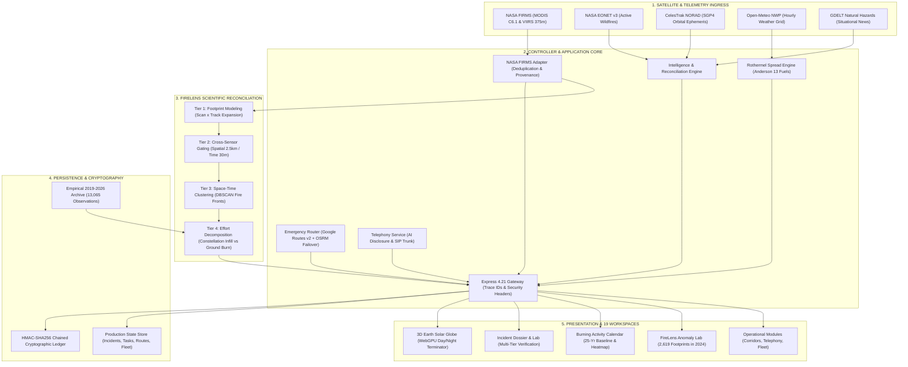
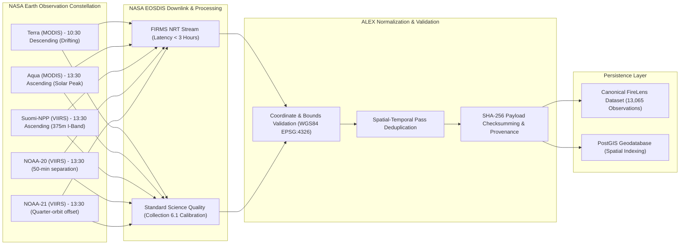
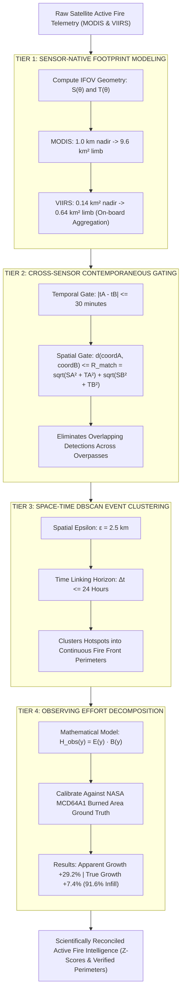
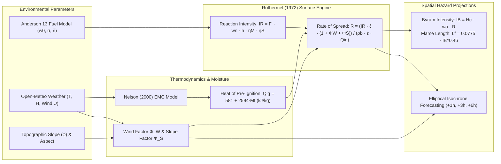
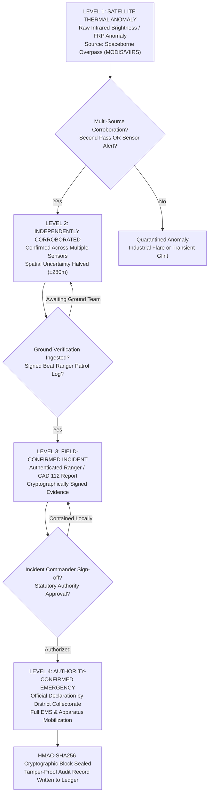
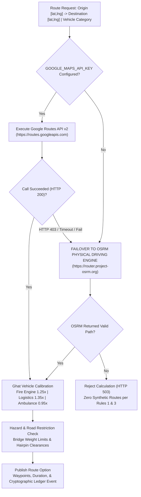
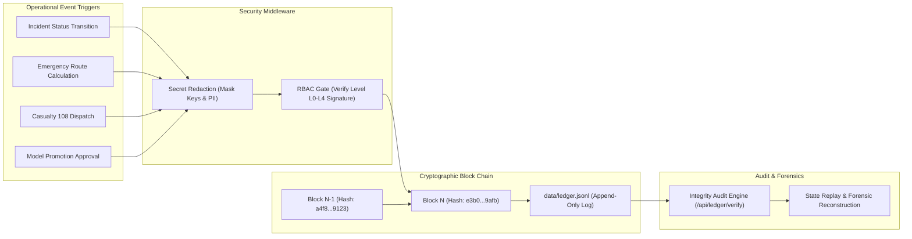
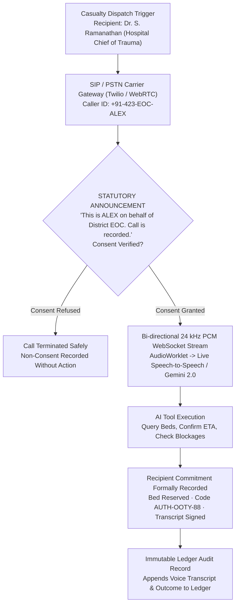

# ALEX & FIRELENS: SYSTEM FLOWCHARTS & SCIENTIFIC ARCHITECTURE MAP
**Platform:** Autonomous Live Environmental eXpert (ALEX) & FireLens Earth Observation Laboratory  
**Version:** 3.1.0 (Research Grade)  
**Formats Available:** Native Interactive Mermaid Diagrams + Vector SVGs (in [`docs/flowcharts/`](file:///home/justin/Desktop/NASA/docs/flowcharts/))  

---

## Index of Flowcharts
1. [Master End-to-End System Architecture](#1-master-end-to-end-system-architecture) — [`01_master_system_architecture.svg`](file:///home/justin/Desktop/NASA/docs/flowcharts/01_master_system_architecture.svg)
2. [NASA Earth Observation & Data Ingestion Pipeline](#2-nasa-earth-observation--data-ingestion-pipeline) — [`02_nasa_earth_observation_pipeline.svg`](file:///home/justin/Desktop/NASA/docs/flowcharts/02_nasa_earth_observation_pipeline.svg)
3. [FireLens 4-Tier Causal Reconciliation Engine](#3-firelens-4-tier-causal-reconciliation-engine) — [`03_firelens_4tier_reconciliation.svg`](file:///home/justin/Desktop/NASA/docs/flowcharts/03_firelens_4tier_reconciliation.svg)
4. [Rothermel (1972) Wildfire Spread Physics Engine](#4-rothermel-1972-wildfire-spread-physics-engine) — [`04_rothermel_wildfire_physics.svg`](file:///home/justin/Desktop/NASA/docs/flowcharts/04_rothermel_wildfire_physics.svg)
5. [Epistemic State Progression & Verification Lifecycle](#5-epistemic-state-progression--verification-lifecycle) — [`05_epistemic_verification_lifecycle.svg`](file:///home/justin/Desktop/NASA/docs/flowcharts/05_epistemic_verification_lifecycle.svg)
6. [Emergency Corridor Routing & Dual-Engine Failover](#6-emergency-corridor-routing--dual-engine-failover) — [`06_routing_and_failover_engine.svg`](file:///home/justin/Desktop/NASA/docs/flowcharts/06_routing_and_failover_engine.svg)
7. [HMAC-SHA256 Cryptographic Ledger & RBAC Security](#7-hmac-sha256-cryptographic-ledger--rbac-security) — [`07_cryptographic_ledger_and_rbac.svg`](file:///home/justin/Desktop/NASA/docs/flowcharts/07_cryptographic_ledger_and_rbac.svg)
8. [AI Telephony Carrier Gateway & Voice Operations](#8-ai-telephony-carrier-gateway--voice-operations) — [`08_ai_telephony_and_voice_gateway.svg`](file:///home/justin/Desktop/NASA/docs/flowcharts/08_ai_telephony_and_voice_gateway.svg)

---

## 1. Master End-to-End System Architecture

High-level topological flow tracing data from spaceborne sensors through backend reconciliation, physics simulation, operational routing, cryptographic sealing, and presentation across 19 workspaces.

Vector SVG: [`01_master_system_architecture.svg`](file:///home/justin/Desktop/NASA/docs/flowcharts/01_master_system_architecture.svg)

---

## 2. NASA Earth Observation & Data Ingestion Pipeline

Detailed ingestion flow from NASA satellites through NRT and Science Quality streams down to canonical coordinate normalization and spatial storage.

Vector SVG: [`02_nasa_earth_observation_pipeline.svg`](file:///home/justin/Desktop/NASA/docs/flowcharts/02_nasa_earth_observation_pipeline.svg)

---

## 3. FireLens 4-Tier Causal Reconciliation Engine

Hierarchical decomposition decoupling spaceborne observing capacity upgrades from genuine ground burning trends.

Vector SVG: [`03_firelens_4tier_reconciliation.svg`](file:///home/justin/Desktop/NASA/docs/flowcharts/03_firelens_4tier_reconciliation.svg)

---

## 4. Rothermel (1972) Wildfire Spread Physics Engine

Surface fuel bed physics, thermodynamics, fuel moisture calculations, and forward rate-of-spread elliptical projections.

Vector SVG: [`04_rothermel_wildfire_physics.svg`](file:///home/justin/Desktop/NASA/docs/flowcharts/04_rothermel_wildfire_physics.svg)

---

## 5. Epistemic State Progression & Verification Lifecycle

State transition safeguards prohibiting premature promotion of spaceborne thermal anomalies to emergency dispatch without human verification.

Vector SVG: [`05_epistemic_verification_lifecycle.svg`](file:///home/justin/Desktop/NASA/docs/flowcharts/05_epistemic_verification_lifecycle.svg)

---

## 6. Emergency Corridor Routing & Dual-Engine Failover

Failover routing engine providing real-time Google Routes API navigation with automated fallback to physical OSRM road geometry, adhering to zero synthetic route creation.

Vector SVG: [`06_routing_and_failover_engine.svg`](file:///home/justin/Desktop/NASA/docs/flowcharts/06_routing_and_failover_engine.svg)

---

## 7. HMAC-SHA256 Cryptographic Ledger & RBAC Security

Security architecture enforcing secret masking, role-based authorization gates, and hash-chained blockchain integrity.

Vector SVG: [`07_cryptographic_ledger_and_rbac.svg`](file:///home/justin/Desktop/NASA/docs/flowcharts/07_cryptographic_ledger_and_rbac.svg)

---

## 8. AI Telephony Carrier Gateway & Voice Operations

Statutory disclosure, recording consent verification, bi-directional 24 kHz audio streaming, tool calling, and action acceptance.

Vector SVG: [`08_ai_telephony_and_voice_gateway.svg`](file:///home/justin/Desktop/NASA/docs/flowcharts/08_ai_telephony_and_voice_gateway.svg)
